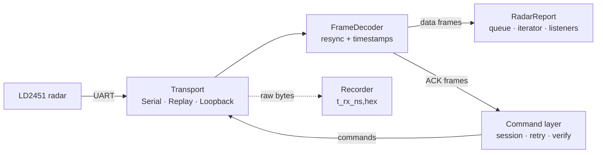

<div align="center">

# ld2451

**A robust Python driver and CLI for the Hi-Link HLK-LD2451 24 GHz vehicle-detection radar.**

[](https://github.com/bfMendonca/ld2451/actions/workflows/ci.yml)
[](pyproject.toml)
[](LICENSE)
[](https://github.com/astral-sh/ruff)
[](https://mypy-lang.org/)
[](https://github.com/bfMendonca/ld2451/stargazers)

[Features](#features) ·
[Wiring](#wiring) ·
[Install](#installation) ·
[CLI](#command-line) ·
[API](#python-api) ·
[Protocol](docs/protocol.md) ·
[Contributing](CONTRIBUTING.md)

</div>

---

`ld2451` talks to the [HLK-LD2451](https://www.hlktech.com/en/Goods-245.html) over its UART:
it streams target reports (angle, distance, speed, direction, SNR), reads and writes every
configuration command in the vendor's V1.03 serial protocol, and records and replays raw
sessions so you can work without hardware.

It runs on a Raspberry Pi Zero (Raspberry Pi OS 32-bit, ARMv6) as well as on desktop Linux,
and its only runtime dependency is [`pyserial`](https://pypi.org/project/pyserial/).

## Features

- **Continuous streaming** with automatic frame resynchronisation and a per-frame arrival
  timestamp (`CLOCK_BOOTTIME` on Linux, `monotonic` elsewhere; the clock can be injected).
- **Safe configuration**: the config session is always closed, commands time out and are
  retried, writes are verified by reading them back, and destructive commands need an
  explicit `confirm=True`.
- **Resilient I/O**: reconnects with backoff when the serial port goes away, and keeps
  counters for frames, errors and drops.
- **Record and replay** of the raw byte stream (`t_rx_ns,hex` CSV) with the original timestamps.
- **Several ways to consume reports**: a blocking iterator, polling with a timeout, or
  callbacks. That makes it easy to plug into executors and timers, for example a ROS 2 node.
- **Side-effect-free import**: no ports, threads, prints, signal handlers or `logging`
  setup at import time, and no global state.
- **Fully typed** (`py.typed`, `mypy --strict`), with unit, property-based (Hypothesis),
  golden-vector and PTY tests. Hardware tests are opt-in.

## How it works



A background reader thread pulls bytes from a `Transport`, splits them into frames, and
routes data frames to your code and ACK frames to the command layer.

## Wiring

Raspberry Pi Zero example:

| Radar | Pi Zero (physical pin) |
| --- | --- |
| 5V | 2 (5 V) |
| GND | 6 (GND) |
| TX | 10 (GPIO15, RXD) |
| RX | 8 (GPIO14, TXD) |

The radar's UART uses 3.3 V TTL levels. Enable the hardware serial port first:

```sh
sudo raspi-config   # Interface Options → Serial Port:
                    #   login shell over serial? No
                    #   serial port hardware enabled? Yes
sudo reboot
ls -l /dev/serial0
```

Your user must be in the `dialout` group to open the port.

## Installation

```sh
pip install git+https://github.com/bfMendonca/ld2451.git
```

Or from a clone:

```sh
git clone https://github.com/bfMendonca/ld2451.git
cd ld2451
pip install .                # or: pip install -e '.[dev]' for development
```

## Command line

```sh
ld2451 monitor --port /dev/serial0          # live targets (--json, --count N, --stats)
ld2451 info                                 # firmware, detection parameters and sensitivity
ld2451 config --max-distance 30 --direction both --min-speed 3 --delay 2
ld2451 config --trigger-count 2 --snr-threshold 5
ld2451 config --set-baudrate 256000 --yes --restart   # persistent; then pass --baudrate 256000
ld2451 config --factory-reset --yes --restart
ld2451 record session.csv --duration 60
ld2451 replay session.csv [--realtime] [--json]
```

`-v` / `-vv` raise the log level. Values are range-checked before the port is opened.

Example `monitor` output:

```text
1234.567890 targets=1 [+10deg 40m approaching 60km/h snr=21]
```

## Python API

```python
from ld2451 import LD2451, SerialTransport, DetectionParams, Direction

with LD2451(SerialTransport("/dev/serial0")) as radar:   # opens the port, starts the reader
    print(radar.get_firmware().version)                  # opens and closes a config session
    radar.set_params(DetectionParams(
        max_distance_m=30, direction=Direction.BOTH, min_speed_kmh=3, no_target_delay_s=2,
    ))                                                    # verified by read-back (verify=True)

    for report in radar.reports():                        # blocking iterator
        for t in report.targets:
            print(report.t_rx_ns, t.angle_deg, t.distance_m, t.speed_kmh, t.approaching)
```

<details>
<summary><b>Callbacks, polling and injectable clocks</b></summary>

```python
radar = LD2451(SerialTransport("/dev/serial0"), clock=my_clock_ns)  # injectable clock
radar.add_listener(lambda report: publish(report))   # runs on the reader thread
radar.open(); radar.start()
report = radar.get_report(timeout=0.1)               # or poll with a timeout
print(radar.stats)                                   # counters
radar.stop(); radar.close()                          # stop() returns within a bounded time
```

</details>

<details>
<summary><b>Several commands in one config session</b></summary>

```python
with radar.config_session() as info:      # 0x00FF on enter, 0x00FE always on exit
    fw = radar.get_firmware()
    params = radar.get_params()
    sens = radar.get_sensitivity()
```

Destructive commands need `confirm=True`: `set_baudrate(b, confirm=True)` and
`factory_reset(confirm=True)`. Both take effect only after `restart()`.

</details>

<details>
<summary><b>Offline replay</b></summary>

```python
from ld2451 import LD2451, ReplayTransport

with LD2451(ReplayTransport("session.csv"), reconnect=False) as radar:
    for report in radar.reports(timeout=0.5):
        ...
```

Reports keep the timestamps from the original recording.

</details>

## Protocol

The driver implements every command documented in Hi-Link's *LD2451 Serial Communication
Protocol V1.03*. [`docs/protocol.md`](docs/protocol.md) describes the frame layout, every
command with its byte examples, and the places where the manual contradicts itself or the
hardware. Bluetooth and engineering mode are not implemented because the manual does not
document them.

The manual is copyrighted by Hi-Link and is not included in this repository.
[`docs/vendor/SOURCES.md`](docs/vendor/SOURCES.md) lists where to download it, along with
the SHA-256 of the copy used.

Tested on hardware with firmware `V1.13.25070114`. Checks that are still pending, such as
those that need a moving target, are tracked in [`docs/hardware-checks.md`](docs/hardware-checks.md).

## Development

```sh
pip install -e '.[dev]'
pytest                                   # no hardware needed; @pytest.mark.hw tests are skipped
pytest --hw --port=/dev/serial0 tests/test_hw.py   # on the Pi, with the radar connected
ruff check . && ruff format --check . && mypy
tox                                      # Python 3.9–3.13 + lint
```

See [CONTRIBUTING.md](CONTRIBUTING.md) for guidelines.

## Star history

<a href="https://star-history.com/#bfMendonca/ld2451&Date">
  <picture>
    <source media="(prefers-color-scheme: dark)" srcset="https://api.star-history.com/svg?repos=bfMendonca/ld2451&type=Date&theme=dark" />
    <source media="(prefers-color-scheme: light)" srcset="https://api.star-history.com/svg?repos=bfMendonca/ld2451&type=Date" />
    
  </picture>
</a>

## License

[MIT](LICENSE) © Bruno Mendonça

*This project is not affiliated with or endorsed by Shenzhen Hi-Link Electronic Co., Ltd.
"Hi-Link" and "HLK-LD2451" are used only to identify compatible hardware.*
